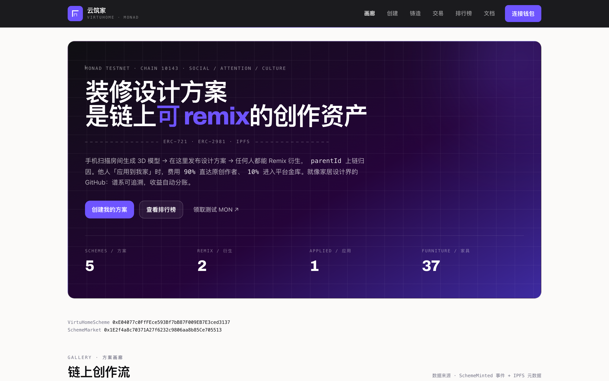
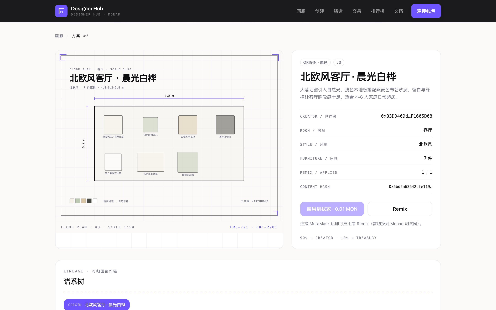
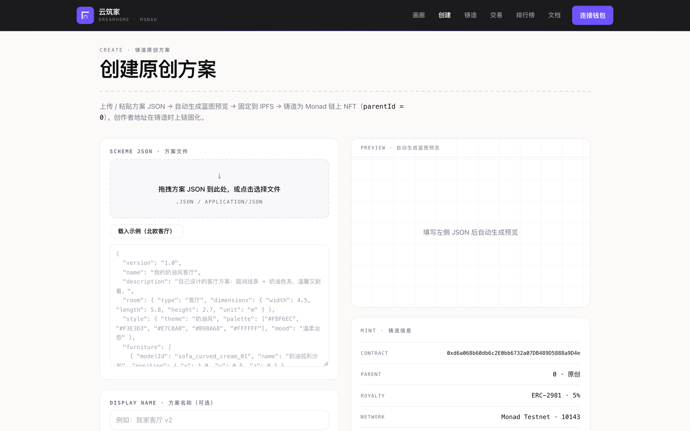
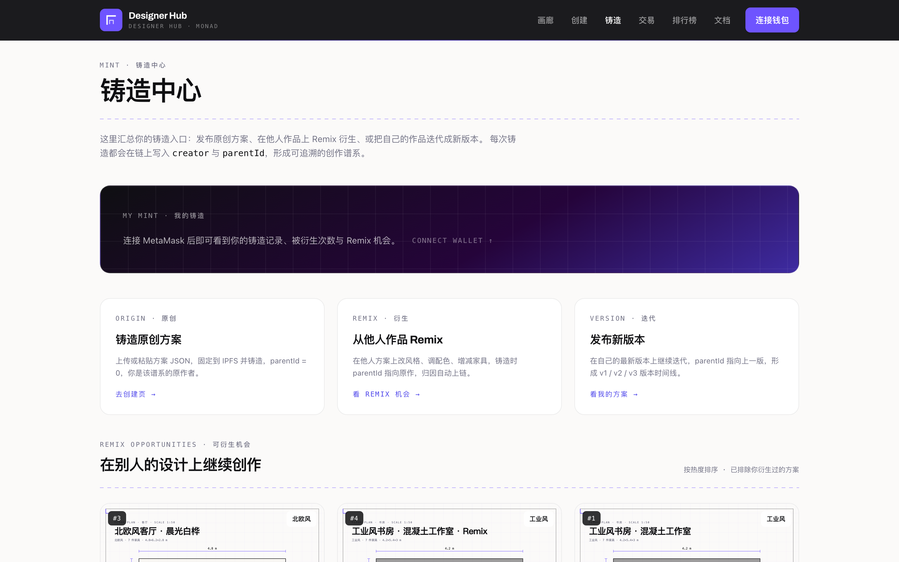
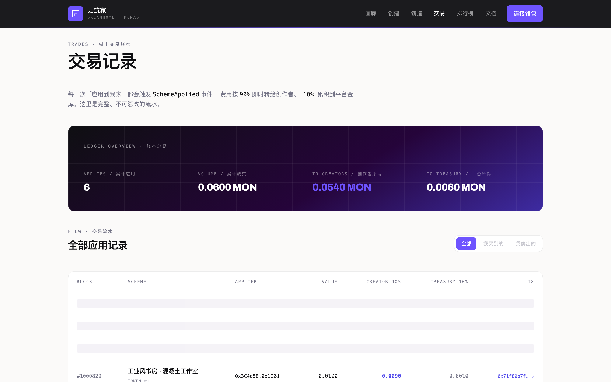
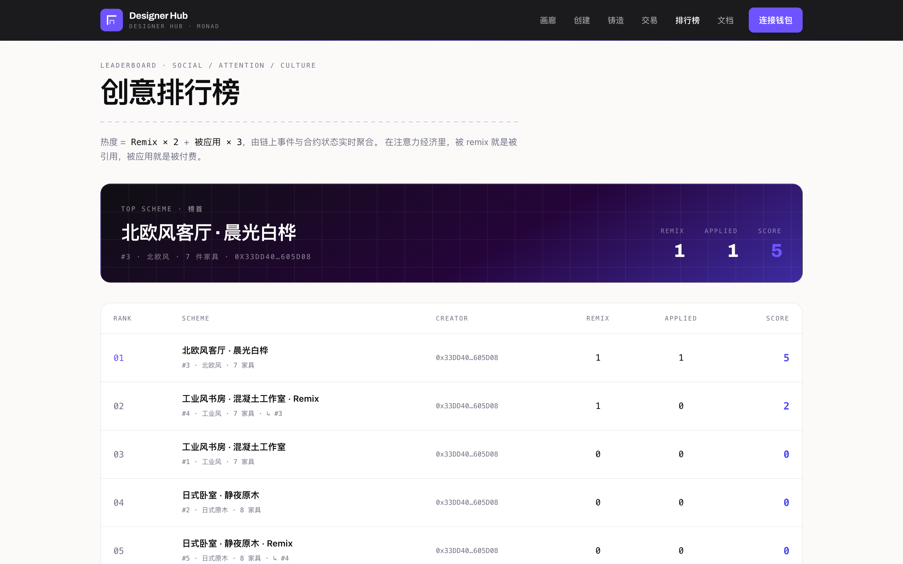
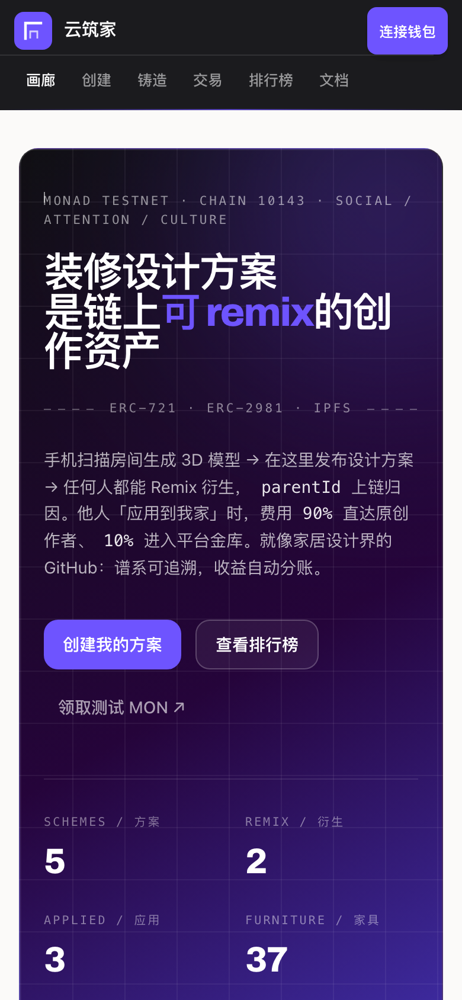
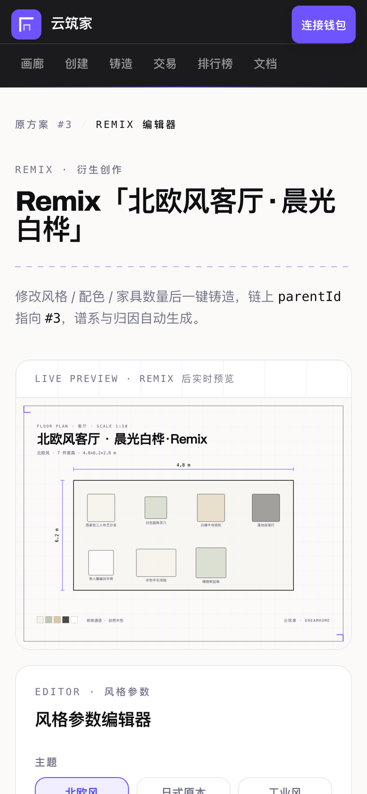

# Designer Hub · Monad

> **Turn exported interior-design schemes into on-chain creative assets that can be remixed,
> attributed, and revenue-shared — a GitHub for home design.**
>
> Monad Metropolis hackathon track: **04 — Trust, Identity & AI Infrastructure**.

One scheme JSON in, one ERC-721 scheme NFT out. Every reference and every payment afterwards
leaves an on-chain trace. Attention (remix count × times-applied) becomes an asset, aggregated
from chain events in real time into a leaderboard. When an author iterates on their own work,
`parentId` points to their previous version, forming an on-chain **v1 → v2 → v3 timeline**.
Comments are stored off-chain with wallet-signature verification (SIWE-style), at zero gas.

**In one line:** we want AIGC output to behave like registrable, traceable, tradable digital
assets — verifiably owned, safely circulated and fairly paid out, without exposing user privacy
or adding Web3 friction.

---

## Why we built it

Generative AI can now produce interior-design schemes at speed, but the moment a designer needs to
**deliver, publish, circulate or trade** one, the pipeline breaks:

- **The provenance object is composite and has no dedicated tool.** A scheme is not one image — it
  bundles client-privacy context, design drafts, furniture and cross-layer assets. You cannot simply
  watermark it, and no convenient provenance tool covers it.
- **Provenance is a market blank.** There is no neutral on-chain record, so a creator cannot prove
  which model or agent produced an asset; once a scheme is exported and remixed, lineage breaks and
  revenue can no longer be traced or split programmatically.
- **Nothing is built for workflow, transfer or trading.** Existing platforms either rely on custodial
  vaults that freeze funds behind cumbersome withdrawals, or dump Web3's barriers — mnemonic wallets
  and gas — directly onto mainstream users.

Designer Hub is not another AI image generator. It lays the missing settlement layer for AIGC-era
creative work: **provenance and trading happen on-chain while sensitive content stays off-chain.**

---

## Hackathon: Track 04, bounties & judging

Built for the **Monad Metropolis** hackathon (build window 1 Sep – 13 Oct; judging 14–27 Oct;
winners 3 Nov). Track 04 — Trust, Identity & AI Infrastructure:

> "AI has made identity, provenance, data ownership, and agent trust urgent infrastructure problems.
> Best fit for teams comfortable with cryptography, protocol design, or agent frameworks."
> — passkey-native accounts using P256 + WebAuthn, agent identity & reputation, provenance for
> generated media that survives re-encoding. **Prize pool: $30,000 per track** (evenly between 3 teams).

### How we map to Track 04

| Track 04 signal | What Designer Hub ships |
| --- | --- |
| Passkey-native accounts using P256 + WebAuthn, no seed phrase | `P256PasskeyAccount` + `PasskeyAccountFactory` — CREATE2 deterministic accounts; real WebAuthn assertions verified on-chain in pure Solidity (RIP-7212 fallback); the key stays in the device secure chip |
| Agent identity & reputation | `AgentRegistry` — AI generators register and accrue reputation from real attestations; `agentId` binds every mint to its model |
| Provenance for generated media | `ProvenanceRegistry` — stores only `keccak256(contentHash ‖ salt)`; raw content never goes on-chain; survives re-encoding |
| Cryptography / protocol design | on-chain P-256 verifier, tamper-proof WebAuthn challenge binding, lineage-aware splitter |

### Bounties this project targets

Metropolis awards sponsor bounties on top of the track prizes. Designer Hub is built to be
eligible for the following (official Monad bounty list):

| Bounty | Sponsor | Why Designer Hub fits |
| --- | --- | --- |
| **Best Builds Powered by KIMI** — $3,000 in credits | Moonshot AI / KIMI | KIMI is the pre-registered generator (`agentId = 1`) and the `/api/kimi` design-suggestion engine; every KIMI-authored scheme is attributable on-chain |
| **Best Builds with Qwen** — $5,000 in credits | Alibaba Qwen | the `AgentRegistry` is provider-agnostic (Qwen = `agentId 2`); schemes carry the generating provider on-chain |
| **Best Use of Envio** — $1,000 | Envio | the `envio/` indexer streams `SchemeMinted` / `SchemeApplied` / `Attested` into the activity feed |
| **Best Projects using Alchemy** — $1,000 in credits | Alchemy | Alchemy RPC + webhook integration (`web/docs/ALCHEMY.md`, `/api/alchemy/webhook`) |
| **Best Analytics / Risk Tool** — $3,000 | — | `AgentRegistry` reputation + per-agent analytics over on-chain attestations |
| **Mera: One Passkey, Many Keys** — $2,500 | Mera | `P256PasskeyAccount` supports up to 4 keys per account (`addKey`) for multi-device recovery |
| **Best Agent Wallet Plugin** — $2,500 | — | a passkey smart account + permissionless relayer as an agent-wallet primitive |

### Judging rubric alignment

| Criterion | Weight | Where we answer it |
| --- | --- | --- |
| Technical Execution | 20% | [`docs/SECURITY.md`](./docs/SECURITY.md) · 103 Foundry tests · live testnet E2E |
| Design & Craft (DX) | 20% | typed `@designerhub/sdk` · [`docs/INTEGRATING.md`](./docs/INTEGRATING.md) · runnable examples |
| Originality & Track Insight | 15% | content stays off-chain · vault-free instant splits · permissionless relayer |
| Founder & Market Readiness | 25% | named adopters + "why not roll your own" · first-party integrator (VirtuHome) |
| Traction & Path Forward | 20% | integration kit shipped · honest gap + concrete post-event plan |

Full mapping: [`docs/JUDGING-ALIGNMENT.md`](./docs/JUDGING-ALIGNMENT.md).

---

## What it is

Every interior-design scheme is an ERC-721:

- **Mint original** (`parentId = 0`) or **remix** (`parentId` → source; lineage recorded on-chain and fully traceable).
- The **creator sets their own price** (`setPrice`). When someone applies a scheme to their home,
  payment is **split instantly and directly** — there is **no platform vault and no `withdraw()` step**:
  - **Original scheme → 90 / 10** (creator / platform).
  - **Remixed scheme → 85 / 10 / 5** (creator / platform / ancestor lineage pool).
- Resale royalty follows **ERC-2981 (5%)**.
- **AI attribution**: `AgentRegistry` registers AI generators (Kimi is pre-registered as `agentId = 1`);
  `mint` / `remix` carry the generating `agentId` on-chain, so a scheme and the AI that made it are
  publicly attributable. `ProvenanceRegistry` stores a **content commitment** (`keccak256(contentHash ‖ salt)`)
  so the scheme content itself never goes on-chain, yet provenance and a timestamp are provable.

---

## Build on it (developer primitive)

This repo is not only an app — it is a small **on-chain primitive set** you can integrate without our UI.
Use the typed SDK and skip the cryptography:

```bash
npm i @designerhub/sdk viem
```

```ts
import { publicClient, readTotalSupply, readScheme, readSplitPreview } from "@designerhub/sdk";

const client = publicClient();                 // Monad Testnet
const s = await readScheme(client, await readTotalSupply(client));
console.log(s.creator, s.parentId, s.remixCount, s.priceWei);
```

Source: [`sdk/`](./sdk) (typed, buildable, not yet published to npm).

**Documentation:**

| Doc | What's inside |
| --- | --- |
| [`docs/INTEGRATING.md`](./docs/INTEGRATING.md) | the primitive, adopters & “why not roll your own”, integration paths, gas sponsorship, post-event plan |
| [`docs/SECURITY.md`](./docs/SECURITY.md) | threat model, P-256/WebAuthn correctness, relayer trust, secrets handling |
| [`docs/JUDGING-ALIGNMENT.md`](./docs/JUDGING-ALIGNMENT.md) | repo vs the judging rubric (evidence, gaps, actions) |
| [`sdk/README.md`](./sdk/README.md) | SDK API reference + examples |

---

## Relationship to the VirtuHome App

This repo is **fully decoupled** from the VirtuHome App; they are two repositories that only hand off a scheme JSON:

| Repo | Responsibility | URL |
| --- | --- | --- |
| **virtu-home** | The VirtuHome App itself: phone-scan a room → server rebuilds 3D → desktop workbench → **export scheme** | <https://gitee.com/freyahhhhh/virtu-home> |
| **monad-competition** (this repo) | The on-chain creative asset: **create / mint / remix / trade / leaderboard** | <https://gitee.com/freyahhhhh/monad-competition_-designer-github> |

```text
VirtuHome App (virtu-home)                          this repo (monad-competition)
┌────────────────────────────┐                  ┌───────────────────────────────────┐
│ phone scan → 3D → decorate │                  │ ⑦ Gallery feed / leaderboard        │
│                            │                  │ ⑥ Remix (parentId on-chain)         │
│        export scheme JSON ─┼── same JSON ────▶│ ⑤ Mint ERC-721 scheme NFT           │
│      (room + style + items)│                  │ ④ /api/pin → IPFS pin               │
└────────────────────────────┘                  │ ③ Passkey login → CREATE2 account   │
                                                │ ⑧ Apply-to-my-home → instant split  │
                                                └───────────────────────────────────┘
```

**This repo depends on none of the App's services.** `assets/schemes/` ships 3 sample schemes
(Nordic living room, Japanese bedroom, Industrial study); `npm run seed` mints them as initial
schemes to remix from.

---

## Architecture

```
┌──────────────────────────── web/ ────────────────────────────┐
│ Next.js 14 App Router + TS + viem + wagmi + RainbowKit        │
│                                                                │
│ /demo /passkey /mint /mint/create /scheme/[id] /remix/[id]    │
│   /trades /board /docs                                        │
│   │ enumerate by totalSupply() + IPFS metadata                │
│   │ writes: mint / remix / applyScheme / setPrice             │
│   ├─ /api/relay    demo gas sponsor for passkey accounts      │
│   ├─ /api/pin      scheme JSON + preview → Pinata → ipfs://   │
│   ├─ /api/kimi     design suggestions via Kimi (local fallback)│
│   ├─ /api/comment  comments (wallet-signature verified, no gas)│
│   └─ /api/cid      read local:// demo mode                    │
└──────────────┬─────────────────────────┬─────────────────────┘
               ▼                         ▼
┌────────────────────────┐   ┌────────────────────────────────┐
│   Monad Testnet        │   │  IPFS (Pinata, local fallback)  │
│   Chain ID 10143       │   │  scheme JSON / preview / meta   │
│   5 contracts (below)  │   │  contentHash = keccak256()      │
└────────────────────────┘   └────────────────────────────────┘
```

---

## Contracts

| Contract | Description |
| --- | --- |
| `DreamScheme` | ERC-721 + ERC-2981 (5%). `mint(parentId, contentHash, agentId, metadataURI)` and `remix(...)`; `parentId = 0` = original, `> 0` = remix source. `creatorOf`, `parentOf`, `contentHashOf`, `agentIdOf`, `lineageOf` (full ancestry), `versionLineOf` (same-author v1/v2/v3 chain), `childrenOf`, `remixCount`. Event `SchemeMinted`. |
| `SchemeMarket` | **Creator set price, instant split.** `setPrice(tokenId, price)`; `applyScheme(tokenId)` payable → splits instantly: **90/10** (original) or **85/10/5** creator/platform/ancestor-pool (remixed). No vault, no `withdraw()`. `splitPreview` for dry-runs, `priceOf`, `appliedCount`. Events `PriceSet`, `SchemeApplied`, `AncestorPaid`. |
| `AgentRegistry` | AI-generator registry + reputation. `registerAgent(metadataURI)`, `isRegistered`, `reputationOf`. Kimi pre-registered as `agentId = 1`. Event `AgentRegistered`, `ReputationAdded`. |
| `ProvenanceRegistry` | Privacy-first content attestation. Stores only `commitment = keccak256(contentHash ‖ salt)` (content stays off-chain). Direct `attest(...)` for self-paying EOA/smart accounts, or `attestByRelayer(AttestRequest, signature)` with an EIP-712 authorization. Event `Attested`. |
| `P256PasskeyAccount` + `PasskeyAccountFactory` | Mnemonic-free WebAuthn/passkey smart account. The factory derives a **CREATE2** address from `(x, y, rpIdHash, originHash)`; `execute` / `executeBatch` verify a P-256 WebAuthn assertion over a challenge that binds `account ‖ chainId ‖ nonce ‖ to ‖ value ‖ keccak256(data)` — so any relayer may submit and pay gas without being able to tamper with the call. Up to 4 keys per account (`addKey`) for multi-device recovery. |

Splitting details: creator addresses are fixed at mint time and survive NFT transfers; the platform
share accrues to `platformAddress`; the ancestor pool is distributed across a deduplicated lineage
(depth cap 16), with dust routing to the platform.

---

## Deployed addresses (Monad Testnet, Chain ID 10143)

| Contract | Address |
| --- | --- |
| `DreamScheme` | `0x2541eB7A4AC7bb5287A5944452576f983b3dc3eB` |
| `SchemeMarket` | `0x51DBCb43D2279e7d108753490794f97AA43877a9` |
| `AgentRegistry` | `0x9EB3d5C336c66823577F4FBB1E31dbABcf7c268D` |
| `ProvenanceRegistry` | `0xCe41D2fa11fC3944662b783ac895D3380B8B09ED` |
| `PasskeyAccountFactory` | `0x41E72cc140b30891b34Da45f3ed55a525c758C76` |

- Platform / deployer: `0x33DD409d85115E300B4570EeB6D4DA7eF1605D08`
- Deploy block: `66892530` · Kimi agentId: `1`
- Explorer: <https://testnet.monadexplorer.com> · RPC: `https://testnet-rpc.monad.xyz` · Faucet: <https://faucet.monad.xyz>

### Historical deployments (deprecated)

The previous version used a fixed `0.01 MON` apply price with a platform vault and `withdraw()`, and a
two-contract set. Those contracts are **deprecated and not used by the current front end**; no on-chain
data was migrated. They are listed here for provenance only:

| Old contract | Address | Deploy block |
| --- | --- | --- |
| `VirtuHomeScheme` (old) | `0xE04077c0FfFEce593Bf7bB87F009EB7E3ced3137` | `65618721` |
| `SchemeMarket` (old, fixed 0.01 MON + withdraw) | `0x1E2f4a8c70371A27f6232c9806aa8b85Ce705513` | `65618721` |

---

## Passkey (primary flow) + MetaMask (advanced)

The **primary flow is Passkey** — no mnemonic, no browser extension, and **no need to hold MON**:

1. A passkey (P-256) is created in the device's secure chip (Secure Enclave / StrongBox / TPM) via
   `navigator.credentials.create()`. The private key is **never exportable**.
2. `PasskeyAccountFactory.accountOf(x, y, rpIdHash, originHash)` gives a **deterministic (counterfactual)**
   account address that can be shown before deployment.
3. A **relayer** deploys the account and pays gas.
4. Each on-chain action is authorized by a single WebAuthn assertion (Face ID / Touch ID / Windows Hello).
   The challenge covers the exact calldata hash and nonce, so the relayer cannot alter the operation.

Entry point: [`/passkey`](./web/app/passkey/page.tsx).

**MetaMask remains available as an alternative** (connectable inside the [`/passkey`](./web/app/passkey/page.tsx) page) for developers who
prefer a self-custodied EOA.

### Relayer (`/api/relay`) — demo-grade gas sponsor

- **Testnet only** (chainId `10143`).
- `value` is always **0** — it never forwards ETH/MON.
- **Target allowlist**: this project's 4 contracts, plus the account's own `addKey`.
- **Daily caps**: global and per-account (in-process counters; reset on restart).
- Each `execute` is **simulated before submission**, so a bad signature/challenge is caught before gas is spent.

> Production would add persistent quotas, per-account metering/paid relay, metrics/alerting, and KMS-managed keys.

---

## Directory structure

```text
monad/
├── contracts/                 Foundry project
│   ├── src/DreamScheme.sol        scheme NFT (lineage + ERC-2981 royalty + AI attribution)
│   ├── src/SchemeMarket.sol       creator pricing + instant lineage split
│   ├── src/AgentRegistry.sol      AI generator registry + reputation
│   ├── src/ProvenanceRegistry.sol content-commitment attestation
│   ├── src/P256PasskeyAccount.sol passkey smart account + CREATE2 factory
│   ├── src/lib/{P256,WebAuthn}.sol  P-256 + WebAuthn verification
│   ├── test/                      Foundry tests (103 cases)
│   ├── script/Deploy.s.sol        deploy script (writes deployments/*.json)
│   └── deployments/               deployment records
├── web/                       Next.js 14 front end + API
│   ├── app/                   pages: / (home) · /demo (gallery) · /passkey · /mint · /mint/create · /trades ·
│   │                          /board · /docs · /scheme/[id] · /remix/[id]
│   ├── app/api/               /relay · /pin · /kimi · /comment · /activity · /cid/[cid] · /demo/[id]
│   ├── lib/                   wagmi / contracts / passkey / scheme / IPFS / Pinata / Kimi
│   └── scripts/seed.ts        mint initial schemes from sample data
├── assets/schemes/            3 sample scheme JSONs + SVG previews
├── sdk/                       @designerhub/sdk — typed client (passkey account, provenance, schemes)
├── docs/                      INTEGRATING.md · SECURITY.md · JUDGING-ALIGNMENT.md · screenshots/
└── README.md
```

---

## Quick start

Prerequisites: `foundry` (≥1.0), `node` ≥ 18, a browser with WebAuthn (Chrome/Edge/Safari ≥16), and
optionally MetaMask. Contract dependencies are **vendored** in `contracts/lib` (OpenZeppelin 5.3.0,
forge-std 1.16.2), so no `forge install` is needed.

### 1. Run contract tests

```bash
cd contracts
forge test          # 103 passed (mint / lineage / versions / split amounts / attestation / P-256 · WebAuthn / passkey account)
```

### 2. Get testnet funds

- Network: Chain ID `10143`, RPC `https://testnet-rpc.monad.xyz`, native token MON.
- Faucet: <https://faucet.monad.xyz>. Add Monad Testnet to MetaMask (explorer <https://testnet.monadexplorer.com>).
- *Passkey users don't need MON — the relayer sponsors gas.*

### 3. Deploy contracts

```bash
cd contracts
cp .env.example .env            # set DEPLOYER_PRIVATE_KEY (testnet only!)
forge script script/Deploy.s.sol --rpc-url monad_testnet --broadcast -vv
# prints all contract addresses and writes deployments/monad-testnet.json
```

### 4. Configure and run the front end

```bash
cd web
cp .env.example .env.local
# set NEXT_PUBLIC_*_ADDRESS (see deployments/monad-testnet.json)
# optional: PINATA_KEY/PINATA_SECRET, KIMI_API_KEY, NEXT_PUBLIC_WALLETCONNECT_PROJECT_ID
# optional passkey/relayer: NEXT_PUBLIC_PASSKEY_RP_ID / NEXT_PUBLIC_PASSKEY_ORIGIN, RELAYER_PRIVATE_KEY
npm install
npm run dev        # http://localhost:3000
```

Without Pinata/Kimi credentials the app falls back to a `local://` demo mode and a built-in rule
engine, so the whole flow still works.

### 5. Seed sample schemes

```bash
cd web
npm run seed                       # mint 3 original schemes
SEED_REMIX_FROM=1 npm run seed     # mint a remix with parentId = 1
SEED_APPLY_TOKEN=1 npm run seed    # run one "apply to my home" on #1
```

### 6. End-to-end demo

**Passkey**: open `/passkey` → create passkey → relayer deploys your account → sign one on-chain
attestation (no MON needed).

**Advanced (MetaMask)**: connect on Monad Testnet → faucet → browse `/demo` → create/import a scheme
JSON → pin to IPFS → mint NFT → on the detail page "apply to my home" (instant 90/10 or 85/10/5 split)
→ "Remix" in the style editor → mint a derivative with `parentId` → leaderboard updates live.

Versioning & collaboration:
- On your own latest version's detail page, "🚀 publish new version" mints v(N+1) with `parentId`
  pointing at the previous one; the version timeline appears automatically.
- "Discussion" at the bottom: type a comment → sign with wallet (SIWE-style) → backend `verifyMessage`
  → stored in local JSON, at **zero gas**.

---

## Routes

| Route | Purpose |
| --- | --- |
| `/` | Redirects (307) to `/demo` |
| `/demo` | Scheme gallery feed (enumerate `tokenId` by `totalSupply()` + IPFS metadata) |
| `/passkey` | **Passkey wallet** (primary): create → derive address → relayer deploy → sign on-chain |
| `/mint` | Mint hub: your mint stats, remix opportunities, your schemes |
| `/mint/create` | Create an original scheme (drag/drop or paste scheme JSON → IPFS → mint) |
| `/scheme/[id]` | Scheme detail: lineage tree, version timeline, comments, apply / remix |
| `/remix/[id]` | Style-parameter editor → mint a derivative (`?newVersion=1` targets your own previous version) |
| `/trades` | Trade ledger: `SchemeApplied` stream, splits, my spend/income |
| `/board` | Leaderboard: heat = remixes × 2 + times-applied × 3 |
| `/docs` | Mechanics, on-chain parameters, quick start, FAQ |

---

## UI preview

| Gallery (`/demo`) | Scheme detail |
| --- | --- |
|  |  |

| Create original | Mint hub |
| --- | --- |
|  |  |

| Trades (split ledger) | Leaderboard |
| --- | --- |
|  |  |

| Mobile · gallery | Mobile · remix |
| --- | --- |
|  |  |

> Screenshots use real Monad-testnet on-chain data, not static mocks.

### Demo video (placeholder)

[🎥 Demo video (placeholder — replace the link after recording)](https://youtu.be/REPLACE_ME)

---

## Design & visual language

The front end follows the **Monad visual style** and makes "interior design" the product's visual signature.

- **Palette**: violet `#6E54FF` / deep violet `#4F47EB` / plum `#25043A` / ink `#0F0F12` /
  paper `#FBFAF9` / grey-violet `#727285` / coral `#FFA1A1` / hairline `#ECECEC`.
- **Type**: self-hosted Archivo variable (headings, numerals) + system CJK sans (body) + monospace (addresses, hashes).
- **Signature element — blueprint dimension lines**: dashed dimension lines with end ticks and monospace
  numerals annotating real data (room size, furniture count, lineage depth, split ratios).
- **Card language**: `.sheet` (white card + hairline) / `.sheet-dark` (ink→plum→violet gradient hero);
  spec tables use "monospace uppercase small label + right-aligned value + hairline".
- **Previews**: `lib/scheme.ts`'s `schemeToPreviewSvg()` renders a floor-plan-style preview entirely from the scheme JSON.
- **Mobile**: two-row header; all nav entries remain visible at 390px with no horizontal overflow.

---

## CI

| Platform | File | Trigger | Content |
| --- | --- | --- | --- |
| Gitee Go | `.workflow/forge-test.yml` | push / PR to `main` | `forge build` + `forge test -vv` + `npm ci && npm run build` |
| GitHub Actions | `.github/workflows/ci.yml` | push / PR to `main` | same (two parallel jobs, npm cache) |

Both run **without any secrets** (contract deps are vendored; the front end builds with defaults).

---

## FAQ

- **Relationship to the VirtuHome App**: fully decoupled; only a scheme JSON is handed off. This repo is
  the standalone hackathon deliverable (contracts / front end / sample data). The App itself lives in `virtu-home`.
- **Gallery keeps showing demo data**: `web/.env.local` has no contract addresses, or the dev server was
  not restarted after deployment.
- **Mint fails with a "post-object" style error**: wrong network — switch the wallet to Monad Testnet (10143).
- **Pinata 403**: check `PINATA_KEY/PINATA_SECRET`; without them the local `local://` mode + `/api/cid` is used.
- **Kimi returns nothing**: `KIMI_API_KEY` is unset; the built-in rule engine answers instead.
- **`eth_getLogs is limited to a 100 range`**: Monad's public RPC caps `eth_getLogs` at 100 blocks (deploy-to-latest
  spans millions of blocks). The gallery enumerates via `totalSupply()` (no logs); `/mint` and `/trades`
  history comes from an **offline index** (`cd web && npm run index` → `web/data/activity.json`, committed
  and read via `/api/activity`), plus a recent tail scan of `NEXT_PUBLIC_TAIL_SCAN_BLOCKS` (default 2000).
- **`chain does not support contract multicall3`**: Monad's multicall3 is added in `web/lib/chains.ts`
  (canonical address `0xcA11…CA11`).
- **Wallet `projectId` error**: leave `NEXT_PUBLIC_WALLETCONNECT_PROJECT_ID` empty (MetaMask injected mode is unaffected). To enable WalletConnect (and mobile scanning), get a real `projectId` at <https://cloud.reown.com> and set `NEXT_PUBLIC_WALLETCONNECT_PROJECT_ID` — with no real value the UI shows injected MetaMask only and makes no WalletConnect network calls.
- **Connect-wallet crash (`invalid border=0`)**: caused by `qr@0.7.0` (pulled by `@rainbow-me/rainbowkit` → `cuer`) rejecting the `border: 0` that RainbowKit's wallet QR passes. `package.json` pins `"overrides": { "qr": "0.5.5" }`; run `npm install` after pulling. Do not remove the override or RainbowKit's QR screen will throw `RangeError: invalid border=0` during `render`.
- **Passkey account address differs between visits**: the address is bound to `(passkey, RP ID, Origin)` —
  a different domain or port (localhost ↔ 127.0.0.1) yields a different account. The local record lives in `localStorage`.
- **Passkey flow errors "relayer_disabled"**: set `RELAYER_PRIVATE_KEY` (or `MONAD_PRIVATE_KEY`) to enable the demo sponsor.
- **Comments**: stored in `web/data/comments/<tokenId>.json` (gitignored); a 401 means the signed message
  must exactly match the submitted one and must embed the scheme's token id.
